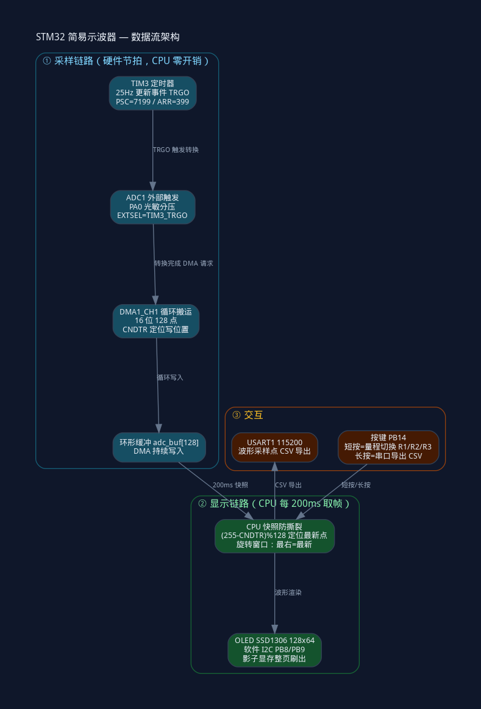

# STM32 简易示波器（寄存器级）

基于 STM32F103C8T6 最小系统板的综合学习项目：**不用标准库，全部寄存器操作**，
从定时采样一路演进到 TIM+DMA 硬件采集 + OLED 波形显示 + 按键交互，共 4 个步骤。

## 架构图



> 架构图源文件：`stm32_arch.dot`（graphviz），修改后 `dot -Tpng -o stm32_arch.png stm32_arch.dot` 重新生成。

## 功能特性（4 步演进）

| 步骤 | 功能 | 核心实现 |
|---|---|---|
| 1 | 定时采集 | SysTick 中断毫秒时钟（g_ms），采样/显示双节拍分离 |
| 2 | OLED 波形 | 影子显存 wbuf[6][128]（软件 I2C 不能读回 → 先画内存再整页刷出） |
| 3 | TIM+DMA 硬件采集 | TIM3 TRGO 触发 ADC1 → DMA1 循环搬运 adc_buf[128]，CPU 零开销采样 |
| 4 | 按键量程 + 串口导出 | 短按切 3 档量程（V/div 概念）、长按导出当前帧 CSV |

采样率 25Hz（TIM3 硬件保证，整屏 5.12s），显示刷新 5Hz。

## 硬件接线

| 模块 | 引脚 | 说明 |
|---|---|---|
| 光敏分压 | PA0（ADC1 通道 0） | 3V3 ─光敏─┬─PA0─10K─GND |
| OLED SSD1306 | PB8=SCL、PB9=SDA | 软件 I2C（0.96 寸四脚版） |
| 按键 | PB14 | 上拉输入，按下拉低 |
| USART1 | PA9=TX、PA10=RX | 115200 8N1，CH340 交叉接 + 共地 |

## 工程结构

```
projects/20_示波器-采集/
├── Project.uvprojx        # Keil 工程（ST-LINK + Reset and Run 已配）
├── Start/                 # 启动文件 + CMSIS（startup_stm32f10x_md.s 中容量）
├── Library/               # STM32 标准库 V3.5.0（OLED 驱动依赖 GPIO/RCC 库）
└── User/
    ├── main.c             # 全部应用代码（寄存器版，含详细注释）
    ├── OLED.c/.h/Font.h   # 商家 SSD1306 驱动（软件 I2C）
    └── stm32f10x_it.c     # SysTick_Handler（g_ms++）
```

## 编译烧录

- 工具：Keil MDK5 + STM32F1xx_DFP 器件包 + ST-LINK（驱动装好即可）
- 打开 `projects/20_示波器-采集/Project.uvprojx` → F7 编译 → F8 下载（工程已配 ST-LINK + Reset and Run；若 Debugger 显示非 ST-Link，Options for Target → Debug 改一下）
- 串口监视器 115200 看 `t=xxx V=xxxxmV`

## 核心知识点与坑（面试价值）

**架构**：TIM3 更新事件(TRGO) → ADC1 外部触发转换 → DMA 循环搬运 → CPU 只取帧。
对比软件轮询：采样率由定时器硬件保证，CPU 采样期间零开销（真示波器架构）。

三个踩过的坑（都是寄存器级才会遇到的）：

1. **TIM CR2 的 MMS 编码**：MMS=010(0x20) 才把更新事件输出到 TRGO；写 100(0x40)=OC1REF，
   输出恒定电平，ADC 永远收不到触发——现象：只转换一次，DMA 计数固定，TIM 的 UIF 却正常置位
2. **初始化顺序（EOC 门控）**：DMA 必须先于 ADC 触发使能——EXTTRIG 置位边沿会触发一次转换，
   DMA 没就绪则结果搬不走，EOC 卡住=1，F103 规则组"结果未读时新触发被忽略"，后续触发全被挡
3. **DMA 环形窗口时间乱序**：循环缓冲写位置随回绕漂移，直接按数组顺序画=时间乱序。
   用 CNDTR 定位最新点 `(255-CNDTR)%128`，画图按下标 `(newest+1+k)%128` 旋转窗口（最右=最新）

其他要点：影子寄存器（PSC/ARR 等 UEV 装载）、三种中断标志清法（EXTI 写1清/TIM 写0清/USART 读清）、
OLED 行映射（行 2 = 页 2~3，撞自定义波形区会被刷掉）、量程=纯显示层增益（读数换算与量程无关）。

## 学习历程

本仓库收录的是 20 个实验学习线中最具代表性的综合项目。完整线从点灯到示波器
（每步一个独立 Keil 工程，寄存器版）：

```
01 工程模板 → 02 寄存器点灯 → 03 流水灯 → 04 蜂鸣器 → 05 按键流水灯
→ 06 引脚验证 → 07 光敏控蜂鸣器 → 08 OLED（软件I2C）→ 09 按键中断（EXTI+NVIC+消抖）
→ 10 定时器中断 → 11 PWM呼吸灯 → 12 PWM舵机 → 13 外部时钟计数
→ 14 输入捕获测频（从模式Reset）→ 15 PWMI测频占空比 → 16 串口printf
→ 17 串口收发（中断接收）→ 18 ADC光敏 → 19 SPI点阵（MAX7219）
→ 20 简易示波器（本仓库，综合前 19 个实验的知识）
```

## 来源

- 学习项目（江协科技 STM32 教程 + 商家开发包），代码为自己寄存器版实现
- OLED 驱动为商家例程（SSD1306 软件 I2C，网上公开流传）
- 完成日期：2026-10-31
